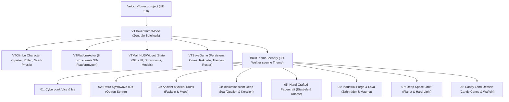

# ⚡ Projekt-Dokumentation & Learnings: Velocity Tower (`Vice & Ice Apex`)

> **Projektstatus: VOLLSTÄNDIG EINSATZBEREIT (Windows x64 + Android ARM64 ASTC) ✅**  
> **Engine:** Unreal Engine 5.8 (C++20, Lumen Dynamic Global Illumination, Nanite, Slate HUD, High-Performance Procedural Audio Mixer)  
> **Repository:** [https://github.com/breakstuff2024/Velotower---Unreal.git](https://github.com/breakstuff2024/Velotower---Unreal.git)  
> **Google Drive Deployment:** `G:\Meine Ablage\VelocityTower-arm64.apk` & `G:\Meine Ablage\Velotowerunreal\`  

---

## 1. Projekt-Übersicht & Architektur

Velocity Tower ist ein rasanter, vertikaler Cyber-Arcade-Climber für PC und Android Mobile. Das Spiel kombiniert präzises Platforming, physikbasierte Wall-Bounces, ein dynamisches 16-Band-Audio-Visualisierungssystem und ein freischaltbares Roster aus 20 Charakteren sowie 8 thematischen Spielwelten.



---

## 2. Zentrale Learnings & Best Practices

### 💡 Learning 1: Die „Nur-Farben-Falle“ vs. echtes 3D-Leveldesign
* **Problem:** Beim anfänglichen Versuch, Themen umzusetzen, wurden lediglich Materialparameter (`BaseColor`, `EmissiveColor`) auf generischen Standard-Cubes ausgetauscht. Das Ergebnis wirkte trotz neuer Farbtöne generisch und enttäuschte die optischen Erwartungen an die Referenzbilder.
* **Lösung & Erkenntnis:** Echte thematische Immersion erfordert **spezifische 3D-Geometrien für Plattformen** sowie **lebendige 3D-Kulissen mit animierten Objekten**:
  * **Papercraft:** Plattformen müssen als echte abgerundete Holz-Eisstiele (Popsicle Sticks) in Bastelfarben mit Washi-Tape modelliert werden; Wände aus Wellpappe mit 3D-Knöpfen (inkl. Nähgarn-Löchern) und Klebeband.
  * **Candy Land:** Plattformen als Marshmallow-Kissenreihe auf Schoko-Waffelriegeln; die Turmecken gesäumt von rot-weißen Spiral-Zuckerstangen (Candy Canes) und herabtropfendem Erdbeer-Icing.
  * **Ancient Ruins:** Klobige Basalt-Slabs mit Moosauflage, schwebenden Runenscheiben und Amethyst-Kristallen; Wände mit Lianen/Efeu, Fackeln und flackerndem Feuerlicht.
  * **Deep Sea:** Organisch gestufte Riffplatten mit biolumineszentem Algenrand; animierte Quallen im Schacht, die sanft auf- und abwogen.
  * **Industrial Forge:** Lochblech-/Gusseisen-Roste mit innen glühendem Hitze-/Lavakern; an den Wänden massive rotierende Industrie-Zahnräder (Cogs) und ein Magma-See am Boden.
  * **Deep Space Orbit:** Hard-Light-Brücken mit Ionen-Triebwerken; riesiger 3D-Planet mit Planetenring im Hintergrund.
  * **Synthwave:** Outrun-Gitterdecks; gigantische 80s-Sonne mit Streifencutouts, Palmensilhouetten und vertikale Laser-Rails.

---

### 💡 Learning 2: Frame-by-Frame Überschreibungen in `Tick`
* **Problem:** Selbst wenn ein Theme korrekt initialisiert wurde, überschrieb die `Tick`-Schleife in `VTTowerGameMode.cpp` jeden Frame die Wandfarben und die Turmbeleuchtung mit `CurBiome.TopColor`. Dadurch blieb im Spielverlauf immer das Standard-Biom dominant.
* **Lösung & Erkenntnis:** `Tick`-Logik muss immer den Zustand des aktiven Themes abfragen:
  ```cpp
  const FVTGameThemeInfo ActiveTheme = GetThemeInfo(bInThemeSelectStage ? PreviewThemeId : SelectedThemeId);
  const FLinearColor ThemeRailCol = ActiveTheme.WallEmissiveColor;
  const FLinearColor BaseRailCol = bBounceReady ? ThemeRailCol : FLinearColor(0.937f, 0.267f, 0.267f);
  ```
  Dynamische Beleuchtung (`TowerMainLight`) muss an `ActiveTheme.LightColor` und `ActiveTheme.LightIntensity` gekoppelt sein.

---

### 💡 Learning 3: Platzierung der Audio-Visualisierung (Equalizer-Balken)
* **Problem:** Wenn die 16 Audio-Reaktions-Balken zentriert hinter dem Spieler liegen und bis zu 680cm hoch ragen, verdecken sie Plattformen, Sprünge und den Charakter im Blickzentrum.
* **Lösung & Erkenntnis:** 
  * Verankerung sauber am **unteren Bildschirmrand** (`CameraZ - 660.0f`).
  * Skalierung auf ein elegantes, dezentes Footer-Spektrum (maximal 180cm Höhe):
    ```cpp
    const float BarHeightCm = Level * 180.0f * (float(CurrentBpm) / 115.0f);
    const float BarZ = CameraZ - 660.0f + BarHeightCm * 0.5f;
    EqualizerBarMeshes[i]->SetWorldLocation(FVector(BarX, 260.0f, BarZ));
    EqualizerBarMeshes[i]->SetWorldScale3D(FVector((BarWidthCm - 12.0f) / 100.0f, 0.20f, BarHeightCm / 100.0f));
    ```
  * Ergebnis: Knackiges Rhythmus-Feedback ohne jede Sichtbehinderung beim Platforming.

---

### 💡 Learning 4: Shader & Vermeidung des „Milchigen Schleiers“
* **Problem:** Zu niedrige Bloom-Schwellenwerte in Kombination mit Standard-Tonemapping führten zu Überstrahlung dunkler Bereiche und einem milchigen Grauschleier über dem Bild.
* **Lösung & Erkenntnis:** In `Config/DefaultEngine.ini`:
  * `r.BloomQuality=5` mit `BloomThreshold=1.25`: Nur echte Neon- und Emissive-Lichter leuchten intensiv, der Hintergrund bleibt tiefdunkel und kontrastreich.
  * Post-Processing: Kontrast `1.24`, Sättigung `1.20`.
  * Charakter-Hervorhebung: Kombination aus steilem Key-Light und intensivem Backlight/Rim-Light, damit die Spielfigur sich messerscharf von dunklen Hintergründen abhebt.

---

### 💡 Learning 5: Kugel-Rolle beim Charakter („Zusammenkauern“)
* **Problem:** Eine einfache Mesh-Skalierung entlang Z stauchte den Charakter unnatürlich oder ließ ihn wie eine zerdrückte Scheibe wirken.
* **Lösung & Erkenntnis:**
  * Verwendung der `MM_Land`-Crouch-Impact-Pose.
  * Sphärische Kauer-Skalierung: `(0.40, 0.38, 0.30)` während des Rollens.
  * Dynamische Pivot-Zentrierung am Bodenkontaktpunkt, um Kollision und Rotationsanimation physikalisch stabil zu halten.

---

### 💡 Learning 6: Android-Packaging & Google Drive Deployment
* **Umgebungsvariablen für UE 5.8 Android ASTC Build:**
  * `ANDROID_HOME = C:\Users\highn\AppData\Local\Android\Sdk`
  * `NDKROOT = C:\Users\highn\AppData\Local\Android\Sdk\ndk\27.2.12479018`
  * `JAVA_HOME = C:\Program Files\Microsoft\jdk-21.0.12.101-hotspot`
* **Automatisierter Build:** `Package_Android_APK.bat` ruft `RunUAT.bat BuildCookRun` mit `-platform=Android -cookflavor=ASTC -clientconfig=Development` auf.
* **Google Drive Integration:** Direkt über das gemountete Google-Drive-Laufwerk (`G:\Meine Ablage\VelocityTower-arm64.apk` und `G:\Meine Ablage\Velotowerunreal\VelocityTower-arm64.apk`).

---

## 3. Übersicht der 8 umgesetzten Spiel-Themes

| # | Theme | Primär-Optik & Plattformen | 3D-Weltkulisse & Umgebung | Kosten |
|---|---|---|---|---|
| **01** | **Cyberpunk Vice & Ice** | Dark Cyber-Deck, Cyan-Neon-Conduits, Kühlrippen | 4 schwebende Hologramm-Billboards mit Kanji-Reklame, ferner Hover-Car-Flugverkehr | 0 Cores (Standard) |
| **02** | **Retro Synthwave 80s** | Outrun-Gitterdeck mit Magenta/Cyan-Gridlines | 5-stufige leuchtende Outrun-Sonne, 3D-Palmen, vertikale Laser-Rails | 50 Cores |
| **03** | **Ancient Mystical Ruins** | Basaltstein-Slab mit Moosauflage & schwebender Runenscheibe | Kaskadierendes Efeublattwerk, 4 Wandfackeln mit flackerndem Feuerlicht | 100 Cores |
| **04** | **Bioluminescent Deep Sea** | Organische Korallenriffplatte, Aquamarin-Algenrand | 3 animierte Tiefsee-Quallen (Schirmatmung & Tentakel), Korallenhörner | 150 Cores |
| **05** | **Hand-Crafted Papercraft** | Bunte Holz-Eisstiele (Popsicle Sticks) mit Washi-Tape | Wellpappe-Wände mit 3D-Knöpfen (Nähgarn-Löcher), Klebestreifen | 200 Cores |
| **06** | **Industrial Forge & Lava** | Gelochter Gusseisen-Rost über glühendem Lavakern | 4 rotierende Industrie-Zahnräder (Cogs), Dampfrohre, Magma-See am Grund | 250 Cores |
| **07** | **Deep Space Orbit** | Hard-Light-Hologrammbrücke mit Ionen-Triebwerken | Riesiger 3D-Planet mit Planetenring im Sternenfeld, Orbitallift-Gantry | 300 Cores |
| **08** | **Candy Land Dessert** | Marshmallow-Kissen auf Schoko-Waffelriegel mit Creme | Zwei riesige rot-weiße Spiral-Zuckerstangen, herabtropfendes Erdbeer-Icing | 350 Cores |

---

## 4. Wichtige Datei-Pfade & Einstiegspunkte

* **Hauptspiellogik:** [`Source/VelocityTower/VTTowerGameMode.cpp`](file:///E:/Projekte/Velocitytower/Source/VelocityTower/VTTowerGameMode.cpp)
* **Plattformen & 3D-Styling:** [`Source/VelocityTower/VTPlatformActor.cpp`](file:///E:/Projekte/Velocitytower/Source/VelocityTower/VTPlatformActor.cpp)
* **Slate HUD & Theme-Showroom:** [`Source/VelocityTower/VTMainHUDWidget.cpp`](file:///E:/Projekte/Velocitytower/Source/VelocityTower/VTMainHUDWidget.cpp)
* **Spieler & Kugel-Rolle:** [`Source/VelocityTower/VTClimberCharacter.cpp`](file:///E:/Projekte/Velocitytower/Source/VelocityTower/VTClimberCharacter.cpp)
* **Datenstrukturen & Enums:** [`Source/VelocityTower/VelocityTowerTypes.h`](file:///E:/Projekte/Velocitytower/Source/VelocityTower/VelocityTowerTypes.h)
* **Level-Referenzen:** [`Levelreferenzen/`](file:///E:/Projekte/Velocitytower/Levelreferenzen/)
* **Android Packaging Skript:** [`Package_Android_APK.bat`](file:///E:/Projekte/Velocitytower/Package_Android_APK.bat)
* **Windows Packaging Skript:** [`Package_Windows_EXE.bat`](file:///E:/Projekte/Velocitytower/Package_Windows_EXE.bat)
